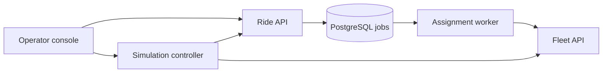

# Ottawa Fleet in two minutes

A small synthetic fleet app for learning how to run services. An operator sees
vehicle availability, requests rides, and follows trips across Ottawa.

**Returning after a break?** Watch the three clips below, then open the console.
The videos have on-screen captions and no audio. They show real services with
synthetic data, recorded with Playwright; they are examples, not a live dashboard.

## Watch what it does

| Short scenario | What to notice |
|---|---|
| [1. Fleet and freshness](videos/01-fleet-and-freshness.webm) | 20 vehicles across Ottawa. An old observation becomes **Unknown** instead of looking live. |
| [2. Trip and refresh](videos/02-trip-and-refresh.webm) | Start one trip, refresh, and recover the same run. Assignment and passenger trip finish separately. |
| [3. Stop and drain](videos/03-stop-and-drain.webm) | Stop new work while an accepted trip finishes. The terminal run has zero incomplete work. |

For an inline player, open [WATCH.html](WATCH.html) from a local clone. GitHub
may offer the WebM files as downloads; any modern browser can play them locally.
Capture date, deployed source revision and scenario outcomes are in
[recordings.json](videos/recordings.json).

## Find your way around the console

1. **Service overview / map:** totals and approximate neighborhood counts.
2. **Route simulation:** bounded demand on the Lansdowne → Centretown route.
   Choose requests, rate, duration and concurrency; opt in before starting.
3. **Fleet availability:** vehicle, zone, seats and observation age. Unknown or
   last-known data must not be read as a fresh position.
4. **Submit a ride / ride history:** accepted requests and durable assignment
   results. Reuse an idempotency key after an uncertain response to reconcile it.

**Two different completions:** an assignment means a vehicle was selected.
A passenger trip may still be in progress. Read the separate **Trip** status.
The simulation moves synthetic vehicles; these are not real GPS observations.

## What happens behind the screen?

Ride API stores the request and job together. The worker claims the job and
reserves a vehicle through Fleet API. The controller runs the trip and reconciles
its effects. PostgreSQL holds history so refreshing the browser does not erase it.

## Open it or record updated clips

- For local startup, follow the [simulation profile](docs/local-development.md#opt-in-route-simulation-profile).
  Its default console is `http://127.0.0.1:18088`.
- For an existing cloud lab, use the platform's
  [port-forward instructions](https://github.com/ANISHG-26/ottawa-fleet-platform/blob/main/docs/runbooks/first-application-deployment.md#sync-and-verify).
  A temporary lab must still be running; localhost alone does not start it.
- To refresh these videos, see the [recording instructions](web/guides/README.md).
  The recorder adds two bounded synthetic runs and keeps their history.

## Where we are

**Working:** durable ride assignment, route simulation, refresh recovery,
stale-data display and Stop and drain. v0.2.1 also runs in the disposable cloud lab.
See [simulation acceptance](docs/simulation-acceptance.md) and
[cloud deployment acceptance](https://github.com/ANISHG-26/ottawa-fleet-platform/blob/main/docs/acceptance/first-application-deployment.md).

**Next on the platform:** measure recovery, demonstrate GitOps drift correction
and compatible rollback. KEDA, Istio, Backstage and AI operations are later work.
The green/blue background is a visual marker, not traffic splitting.

When behavior changes, refresh the relevant clip and this short guide together.
Deeper implementation details stay in [architecture](docs/architecture.md).
